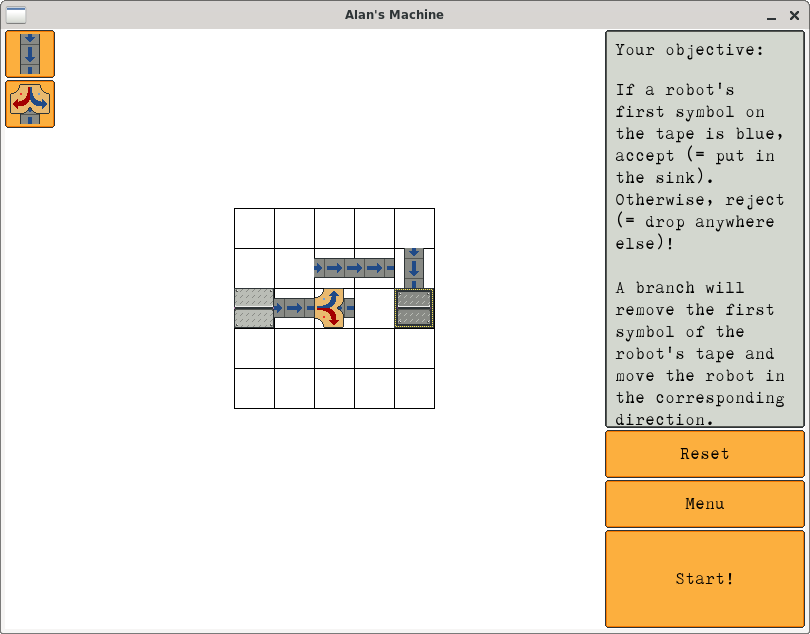

This is my little Wunderkammer, a curio cabinet of ideas, projects I started
and never finished, and things that I want to play around with one day.

If anything here sparks your interest and you build it, let me know -- I would
love to link your project here.

---

## Alans Machine



My attempt at creating an Open Source clone of the SWF game
[Manufactoria](https://www.kongregate.com/en/games/pleasingfungus/manufactoria).
In this puzzle game you place conveyor belts, branches, stamps and detectors to
test robots and separate well-programmed robots from the ones that would go mad
and conquer the world otherwise. If a robot's programming matches the
description, move it to the sink, otherwise drop it anywhere to scrap it.

This game is basically a gameified 2D turing machine, a wonderful time sink and
a perfect device to nerd-snipe any computer science or software engineer. The
levels start out deceptively simple but get very complex fast.

[Download](/wunderkammer/AlansMachine/AlansMachine.zip){: .btn .btn--inverse}

## Build your own x

[https://github.com/codecrafters-io/build-your-own-x](https://github.com/codecrafters-io/build-your-own-x)

Every engineering problem, whether you're building bridges or software, has a
finite set of core principles that govern how solutions work. The variations
are infinite, sure, but the underlying patterns are not. When you recreate a
technology from scratch, you strip away all the production cruft and face the
problem in its purest form.

Building a bridge out of Popsicle sticks teaches you rigid body statics.
Building real bridges has you deal with safety regulations, environment
considerations, labor law, logistics, work schedules and other highly important
but ultimately non-engineering problems.

Building a debugger from scratch teaches you how ptrace on Linux works, how to
implement breakpoints, read and modifying register values, interpret DWARF
sections to map debug information to instructions. This knowledge helped me
working on [GDB](https://sourceware.org/gdb/) professionally, where learning
and understanding these concepts are buried under layers of abstractions
because GDB has to handle remote debugging, work across dozens of architectures
and so on and so forth.

My personal favorite Build-your-own-x's, in no particular order:

- [Ray Tracing in One Weekend](https://raytracing.github.io/books/RayTracingInOneWeekend.html)
- [ugit: DIY Git in Python](https://www.leshenko.net/p/ugit/)
- [My First Language Frontend with LLVM](https://llvm.org/docs/tutorial/MyFirstLanguageFrontend/index.html)
- [Writing a Linux Debugger](https://tartanllama.xyz/posts/writing-a-linux-debugger/setup/)
