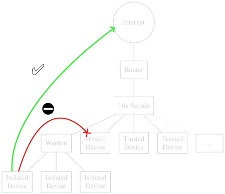

I have a device or two that I on one hand *do* want to have internet access,
but on the other hand *absolutely do not* want to have access to the rest of my
home network. And if my home network wasn't this beautiful piece of art that
has grown over the years in a very organic fashion, I'd be able to simply use
VLANs to isolate those "bad" devices. But alas, that's not a viable solution
here.

So I had to get creative: I have an old-ish FritzBox 7520 available that I
installed [OpenWRT](https://openwrt.org/toh/avm/avm_fritz_box_7530) on. The
idea is to put this box between the to-be-isolated machines and the rest of
the network and configure its firewall so that traffic from the isolated
devices can egress the network towards the internet, but anything towards
devices *in* my home network gets stopped:



Installing OpenWRT on a device is very device specific and out of scope for
this little write up. I left the configuration pretty much stock, only set a
password (generated by `openssl rand -hex 16`) and ssh key for convenience and
changed the device name to "warden".

While I usually am a big fan of OpenWRT's Web UI "Luci", this time I wanted a
more traceable method of making changes, which is to say I ssh'd into the box,
and edited `/etc/config/network`, `/etc/config/dhcp` and `/etc/config/firewall`
directly, after making backups and putting the directory `/etc/config` under
version control with git.

First order of business: Break up the bridge. The FritzBox 7520 has four LAN
ports that after OpenWRT is installed, are configured to be part of a bridge. I
changed that so that each port belongs to a different subnet:

```
# /etc/config/network

config interface 'loopback'
	option device 'lo'
	option proto 'static'
	list ipaddr '127.0.0.1/8'

config interface 'lan'
	option device 'lan1'
	option proto 'dhcp'
	option sendclientid 'auto'

config interface 'bad2'
	option device 'lan2'
	option proto 'static'
	option ipaddr '10.99.2.1/24'

config interface 'bad3'
	option device 'lan3'
	option proto 'static'
	option ipaddr '10.99.3.1/24'

config interface 'bad4'
	option device 'lan4'
	option proto 'static'
	option ipaddr '10.99.4.1/24'
```

Next comes DHCP configuration. I want the warden to be a "regular device" on my
home network, i.e. get its IP address on the `lan` port from my router. For the
quarantine networks `bad2`, `bad3`, and `bad4` I want the warden to *be* the
DHCP server and give out exactly *one* IP address, so that the IP that the
isolated device is assigned, becomes predictable:

```
# /etc/config/dhcp

# authoritative:        In charge for these IPs.
# domainneeded:         Prevent sending queries for single-word hostnames like
#                       "server" to the internet.
# boguspriv:            Allows answering queries for private IP ranges like
#                       the "special host" 192.168.178.99.
# ednspacket_max:       Prevent DNS packets from being fragmented
# rebind_protection:    Prevent remote site to trick browser into attacking a
#                       local IP.
# rebind_localhost:     rebind_protection but for loopback address.
# localservice:         Ensure dnsmasq only listens on interfaces that have an
#                       IP configured

config dnsmasq
	option authoritative '1'
	option domainneeded '1'
	option boguspriv '1'
	option ednspacket_max '1232'
	option rebind_protection '1'
	option rebind_localhost '1'
	option localservice '1'

config dhcp 'lan'
	option interface 'lan'
	option ignore '1'

# Only ever assign the IP address "10.99.X.100" where X is 2, 3, or 4,
# depending on the interface. In reality, there is only ever one device per
# interface / zone, so this is fine.

config dhcp 'bad2'
	option interface 'bad2'
	option start '100'
	option limit '1'
	option leasetime '24h'

config dhcp 'bad3'
	option interface 'bad3'
	option start '100'
	option limit '1'
	option leasetime '24h'

config dhcp 'bad4'
	option interface 'bad4'
	option start '100'
	option limit '1'
	option leasetime '24h'
```

And finally the firewall rules that make the whole thing work together: It is a
bit weird, as we have to explicitly allow traffic from the quarantined zones
into the "trusted" lan, so that it can egress through the router to the
internet, only to then forbid traffic that is directed towards any members of
the home network itself. I much, *much*, prefer solutions where the default is
`reject` and then the individual "good" cases are exempt. So if you know a
better way of doing this, I would love to hear from you.

Additionally, I have added the possibility for a quarantined device to access
one particular, special device on one particular, special port on my home
network (rules `allow-quarantined-special-host-*`). And since I maybe want to
ssh into a quarantined device from my home network, but my home network knows
nothing about the `10.99.*.*` quarantine subnets, I added port-forwarding on
the warden box, so I can run `ssh warden -p 2022` and reach port 22 on the
device connected to the second port of my quarantine warden:

```
# /etc/config/firewall

# Default = No connection.

config defaults
	option input 'REJECT'
	option output 'ACCEPT'
	option forward 'REJECT'
	option synflood_protect '1'

# The "home network" zone: Allowed to access this devices. Traffic into the
# home network is masqueraded as to not leak IPs of quarantined devices.

config zone
	option name 'lan'
	option network 'lan'
	option input 'ACCEPT'
	option output 'ACCEPT'
	option forward 'REJECT'
	option masq '1'
	option mtu_fix '1'

# The quarantine zones.

config zone
	option name 'bad2'
	option network 'bad2'
	option input 'REJECT'
	option output 'ACCEPT'
	option forward 'REJECT'

config zone
	option name 'bad3'
	option network 'bad3'
	option input 'REJECT'
	option output 'ACCEPT'
	option forward 'REJECT'

config zone
	option name 'bad4'
	option network 'bad4'
	option input 'REJECT'
	option output 'ACCEPT'
	option forward 'REJECT'

config forwarding
	option src 'bad2'
	option dest 'lan'

config forwarding
	option src 'bad3'
	option dest 'lan'

config forwarding
	option src 'bad4'
	option dest 'lan'

# Quarantined devices may connect to one special host/port in the home network.

config rule
	option name 'allow-quarantined-special-host-2'
	option src 'bad2'
	option dest 'lan'
	option dest_ip '192.168.178.99'
	option proto 'tcp'
	option dest_port '12345'
	option target 'ACCEPT'

config rule
	option name 'allow-quarantined-special-host-3'
	option src 'bad3'
	option dest 'lan'
	option dest_ip '192.168.178.99'
	option proto 'tcp'
	option dest_port '12345'
	option target 'ACCEPT'

config rule
	option name 'allow-quarantined-special-host-4'
	option src 'bad4'
	option dest 'lan'
	option dest_ip '192.168.178.99'
	option proto 'tcp'
	option dest_port '12345'
	option target 'ACCEPT'

# Quarantined devices may NOT connect to any other device in private ranges,
# i.e. the home network or other quarantined devices. This also blocks access
# to the gateway (192.168.178.1). This is by design, but requires running dns
# and dhcp servers / proxies on this device.

config rule
	option name 'block-private-10-2'
	option src 'bad2'
	option dest 'lan'
	option dest_ip '10.0.0.0/8'
	option proto 'all'
	option target 'REJECT'

config rule
	option name 'block-private-172-2'
	option src 'bad2'
	option dest 'lan'
	option dest_ip '172.16.0.0/12'
	option proto 'all'
	option target 'REJECT'

config rule
	option name 'block-private-192-2'
	option src 'bad2'
	option dest 'lan'
	option dest_ip '192.168.0.0/16'
	option proto 'all'
	option target 'REJECT'

config rule
	option name 'block-private-10-3'
	option src 'bad3'
	option dest 'lan'
	option dest_ip '10.0.0.0/8'
	option proto 'all'
	option target 'REJECT'

config rule
	option name 'block-private-172-3'
	option src 'bad3'
	option dest 'lan'
	option dest_ip '172.16.0.0/12'
	option proto 'all'
	option target 'REJECT'

config rule
	option name 'block-private-192-3'
	option src 'bad3'
	option dest 'lan'
	option dest_ip '192.168.0.0/16'
	option proto 'all'
	option target 'REJECT'

config rule
	option name 'block-private-10-4'
	option src 'bad4'
	option dest 'lan'
	option dest_ip '10.0.0.0/8'
	option proto 'all'
	option target 'REJECT'

config rule
	option name 'block-private-172-4'
	option src 'bad4'
	option dest 'lan'
	option dest_ip '172.16.0.0/12'
	option proto 'all'
	option target 'REJECT'

config rule
	option name 'block-private-192-4'
	option src 'bad4'
	option dest 'lan'
	option dest_ip '192.168.0.0/16'
	option proto 'all'
	option target 'REJECT'

# Quarantined devices must use DNS and DHCP of this device.

config rule
	option name 'allow-quarantined-dns-dhcp-2'
	option src 'bad2'
	option proto 'tcp udp'
	list dest_port '53'
	list dest_port '67'
	option target 'ACCEPT'

config rule
	option name 'allow-quarantined-dns-dhcp-3'
	option src 'bad3'
	option proto 'tcp udp'
	list dest_port '53'
	list dest_port '67'
	option target 'ACCEPT'

config rule
	option name 'allow-quarantined-dns-dhcp-4'
	option src 'bad4'
	option proto 'tcp udp'
	list dest_port '53'
	list dest_port '67'
	option target 'ACCEPT'

# Port forwarding to allow ssh'ing into the quarantined devices without knowing
# their IP addresses. Port 2022 forwards to port 22 on the device in the "bad2"
# zone, port 2023 to "bad3" and port 2024 to "bad4".

config redirect
	option name 'allow-ssh-to-quarantined-2'
	option src 'lan'
	option src_dport '2022'
	option dest 'bad2'
	option dest_ip '10.99.2.100'
	option dest_port '22'
	option proto 'tcp'
	option target 'DNAT'

config redirect
	option name 'allow-ssh-to-quarantined-3'
	option src 'lan'
	option src_dport '2023'
	option dest 'bad3'
	option dest_ip '10.99.3.100'
	option dest_port '22'
	option proto 'tcp'
	option target 'DNAT'

config redirect
	option name 'allow-ssh-to-quarantined-4'
	option src 'lan'
	option src_dport '2024'
	option dest 'bad4'
	option dest_ip '10.99.4.100'
	option dest_port '22'
	option proto 'tcp'
	option target 'DNAT'
```

A bit verbose, but that's it. Feel free to copy these three files to your
OpenWRT machine, they should work right out of the box.
